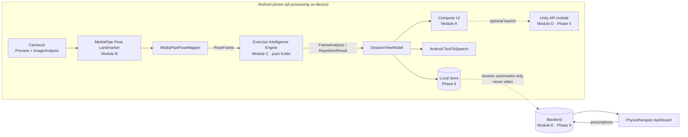
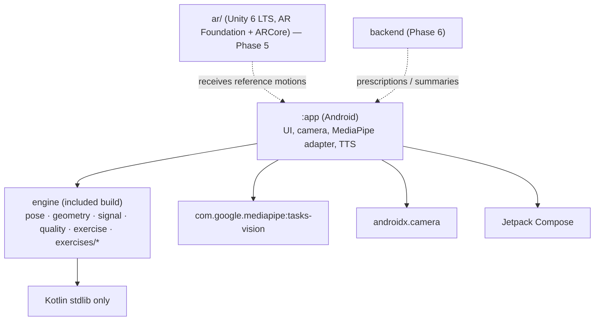
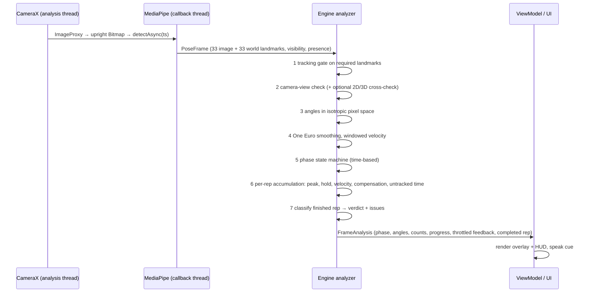

# 02 — PhysioAR unified architecture

## 1. System architecture



## 2. Module dependency diagram



Rule: `engine` must never depend on Android, MediaPipe or UI. That keeps it unit-testable on any
JVM and makes the pose estimator replaceable behind `PoseFrame`.

## 3. Folder structure

```
physioar/
├── README.md                     setup and status
├── THIRD_PARTY_NOTICES.md        attribution for adapted code and models
├── settings.gradle.kts           Android build; includes engine/ as an included build
├── build.gradle.kts, gradle/     version catalog, wrapper
├── engine/                       Module C — standalone Kotlin/JVM build
│   └── src/main/kotlin/com/physioar/engine/
│       ├── pose/                 BodyLandmark (33), PoseFrame, Landmark, BodySide
│       ├── geometry/             vectors, interior angles (2D/3D), inclination, pixel-space conversion
│       ├── signal/               OneEuroFilter, WindowedVelocity
│       ├── quality/              TrackingQualityGate (visibility, presence, in-frame)
│       ├── exercise/             ExerciseDefinition, ExerciseAnalyzer, verdicts, feedback, catalog
│       └── exercises/
│           └── kneeextension/    parameters, definition, analyzer   ← one package per exercise
├── app/                          Module A (+ Module B adapter)
│   └── src/main/java/com/physioar/app/
│       ├── pose/                 PoseLandmarkerHelper (adapted), MediaPipePoseMapper
│       ├── camera/               CameraPreview (CameraX in Compose)
│       ├── session/              SessionViewModel
│       ├── feedback/             SpeechFeedback
│       └── ui/                   screens (library, session, results), components, theme
├── ar/                           Module D — Unity project (Phase 5; README only for now)
└── docs/                         audit, architecture, decisions, exercise specs, validation plan
```

## 4. Data flow per frame



Backpressure: `STRATEGY_KEEP_ONLY_LATEST` drops frames rather than queuing them, so latency
stays bounded on slow phones; the engine uses timestamps, so a variable frame rate does not
change its thresholds.

## 5. Technology selection

| Concern | Choice | Why |
|---|---|---|
| Language/UI | Kotlin, Jetpack Compose, Material 3 | Brief; modern; pose-detection-android shows Compose + CameraX works well. |
| Camera | CameraX 1.4 (Preview + ImageAnalysis, RGBA_8888) | Same as the official sample; lifecycle-aware. |
| Pose estimation | **MediaPipe Pose Landmarker** (`tasks-vision 1.0.0`), *full* model by default, *lite* available | 33 landmarks incl. heel/foot (needed for heel raises), world 3D landmarks, visibility + presence. See ADR-002. |
| Exercise engine | Pure Kotlin/JVM module, rule-based finite-state machines | Deterministic, explainable, testable without devices; no training data exists yet. See ADR-004. |
| Smoothing | One Euro filter (Casiez et al., 2012) + windowed velocity | Low lag while moving, strong smoothing at rest; timestamp-based. |
| Voice | Android `TextToSpeech` | On-device; no extra dependency. |
| DI | None (constructor injection) | Small app; avoids Hilt build cost. Revisit if the app grows. |
| AR | Unity 6 LTS + AR Foundation 6 + ARCore (Phase 5) | Brief; samples available. Kept optional and out of the measurement path. |
| Backend | Decide in Phase 6 (Firebase vs Supabase) | FlexiPose shows Firebase fits the doctor/patient model; Supabase (Postgres + row-level security) is easier to audit for health data. Needs a data-protection decision first. |

## 6. Integration plan

| Phase | Deliverable | Status |
|---|---|---|
| 1 | Repository audit | **Done** — `01-repository-audit.md` |
| 2 | Architecture, decisions | **Done** — this file, `03-integration-decisions.md` |
| 3 | Android MVP: camera, MediaPipe, skeleton, knee angle, seated knee extension, reps, feedback | **Code written.** Engine: built and unit-tested (synthetic data). App: written, **not yet compiled or run** (no Android SDK in the authoring environment). |
| 4 | Remaining five analyzers, one package each, each with its own rules; recorded-video regression harness | Definitions written; analyzers not started |
| 5 | Unity AR demonstration module, launched from the app; reference motions as data | Not started |
| 6 | Backend, auth, prescriptions, history, therapist dashboard | Not started |
| 7 | Validation against physiotherapist assessments | Plan in `05-validation-plan.md` |

### How an exercise is added (Phase 4)

1. `engine/.../exercises/<name>/` — `<Name>Parameters` (prescription, every clinical limit), `<Name>` (definition object), `<Name>Analyzer : ExerciseAnalyzer`.
2. Reuse the building blocks (`TrackingQualityGate`, `OneEuroFilter`, `WindowedVelocity`, geometry), but write the state machine and classification for that movement.
3. Tests with synthetic sequences for every verdict, then recorded-video regression fixtures.
4. Mark `AnalyzerStatus.IMPLEMENTED` in the catalog. The UI picks it up.
